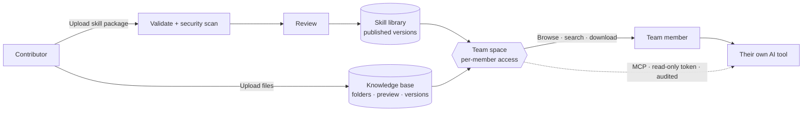
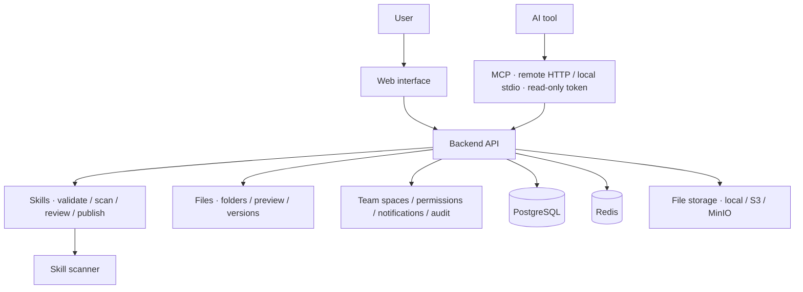

<p align="center">
  
</p>

<h3 align="center">A self-hosted home for your team's AI skills and work files</h3>

<p align="center">
  Skills are reviewed before they are published, files are shared as soon as they are uploaded, and both live in the same team space;<br />
  AI tools read them directly over MCP with your permissions, and your data stays on your own server.
</p>

<p align="center">
  <a href="LICENSE"></a>
  
  
  <a href="#mcp-let-ai-read-your-teams-skills-and-files"></a>
</p>

<p align="center">
  <a href="README.md">简体中文</a> · <strong>English</strong>
  <br />
  <a href="#why-skillhive">Why SkillHive</a> · <a href="#mcp-let-ai-read-your-teams-skills-and-files">MCP</a> · <a href="#live-demo">Live demo</a> · <a href="#product-demos">Product demos</a> · <a href="#features">Features</a> · <a href="#deployment">Deployment</a> · <a href="#development-and-documentation">Development</a>
</p>

## Why SkillHive

**v0.2.0** adds controlled MDX previews, folder uploads that preserve the directory hierarchy, and remote MCP access. See the [release changelog](CHANGELOG.md); the [site changelog](https://skillhive.team/changelog) records the version deployed to the demo site.

<table>
  <tr>
    <td width="33%" valign="top">
      <strong>Self-hosted, your data stays in-house</strong><br /><br />
      Deploy with Docker Compose on your own server or intranet, and store files on local disk, S3 or MinIO. The live demo runs on a single 2-core, 4 GB server.
    </td>
    <td width="33%" valign="top">
      <strong>Skills are reviewed before they reach the team</strong><br /><br />
      Uploaded skill packages pass structure and metadata validation, a <a href="https://github.com/cisco-ai-defense/skill-scanner">Cisco AI Skill Scanner</a> security scan and a human review before they are published, keeping risky scripts out of your team.
    </td>
    <td width="33%" valign="top">
      <strong>Methods and materials in one place</strong><br /><br />
      A team space page lists both its skills and its knowledge bases, and you can search files across knowledge bases. “How to do it” and “what to use” share one entry point.
    </td>
  </tr>
  <tr>
    <td valign="top">
      <strong>Preview files, trace every change</strong><br /><br />
      View PDFs, images and Markdown (with its images) online, preview MDX with built-in components and a source toggle, and preview Word / PowerPoint files in the browser. Every update keeps a version you can download or restore.
    </td>
    <td valign="top">
      <strong>Permissions down to each member</strong><br /><br />
      On top of space roles, set each member to read-only or editable, and decide separately whether they can download. Changes apply immediately, and key operations are recorded in the audit log.
    </td>
    <td valign="top">
      <strong>AI tools read it directly (MCP)</strong><br /><br />
      Through <a href="#mcp-let-ai-read-your-teams-skills-and-files">MCP</a>, Claude Code, Cursor and other AI tools use your read-only token to search and read skills and knowledge files. Connect over remote HTTP or local stdio; the backend checks permissions on each call and audits file reads. Skills use the common <code>SKILL.md</code> format and work with any AI tool; the platform never runs skill scripts itself.
    </td>
  </tr>
</table>

### Compared with the usual way

| | Chat groups, shared drives, personal notes | SkillHive |
| --- | --- | --- |
| Useful AI skills | Scattered across chat history, latest version unclear | Kept in one place with instructions, versions and download counts |
| Skill safety | Used as-is, nobody checks | Published only after validation, security scanning and review |
| Templates and documents | Copies everywhere, hard to tell which is current | One home with traceable version history |
| Finding things | Scroll through chats, ask colleagues | Browse by team space, search across knowledge bases |
| Who can access | Anyone a link is forwarded to | Team members only, with downloads controlled separately |
| Giving AI your team's material | Download and paste into the chat by hand | AI tools read it over MCP with your permissions, and reads are audited |
| Where data lives | A third-party platform | Your own server |

### How it works



For example, a team publishes a meeting-notes skill to the skill library and keeps its meeting templates and project documents in a knowledge base. A new member opens the team space and finds the method and the materials together. Or they simply tell Claude Code "tidy up these notes with our team's meeting-notes skill and template", and the AI finds both over MCP and does the work.

## MCP: let AI read your team's skills and files

SkillHive provides read-only [MCP access](mcp/README.md) over remote Streamable HTTP or local stdio. Once configured, your AI tool uses your own API token to search, browse and read the skills and knowledge files you can access, with no manual downloading or copy-pasting. Read results are passed to the AI tool you choose.

Ask your AI things like:

- "Find the expense-claim documents in our team knowledge base and summarize the key steps."
- "Use the `meeting-notes` skill from our skill library to tidy up these notes."
- "Which frontend skills does our space have? Read the latest version's instructions."

| Property | What it means |
| --- | --- |
| **Read-only** | Use only `skill:read` and/or `knowledge:read`. Tokens with write scopes are refused, so the AI cannot change anything. |
| **Team permissions apply** | Read published public skills and authorized content in your teams. Reading team files requires download permission; platform administrators' tokens cannot bypass membership or download checks. |
| **Files passed through unchanged** | Text files come back as text; PDF, Word and other files are handed to the AI tool as the original file. The platform does no content parsing. |
| **Traceable** | Knowledge files and skill files read with a token are recorded in the audit log, naming the token. |
| **Grant only what you need** | Skill and knowledge access are granted separately, and the MCP server only offers the tools for what the token can reach. |

12 tools: `whoami`; skills: `search_skills`, `get_skill`, `list_skill_versions`, `list_skill_files`, `read_skill_file`, `list_my_skills`; knowledge: `list_knowledge_bases`, `browse_knowledge_base`, `search_knowledge`, `get_document`, `read_document`.

### Remote access: configure a URL and token

The remote endpoint ships with the backend and needs no additional MCP container or local Node.js installation. **After deploying a version containing this feature**, configure an agent that supports Streamable HTTP and custom authentication headers:

1. Open **Profile → API Tokens** and create a read-only token. Set skill access to **Read-only** or **None**; enable **Knowledge (read-only)** when needed.
2. Click **Copy MCP configuration**, or use the JSON below with your own instance URL and token.
3. Enable the MCP connection in your agent, then ask it to find skills or files. Call `whoami` first to confirm the current user and teams.

```json
{
  "mcpServers": {
    "skillhive": {
      "type": "http",
      "url": "https://your-skillhive.example.com/api/v1/mcp",
      "headers": {
        "Authorization": "Bearer <YOUR_READ_ONLY_TOKEN>"
      }
    }
  }
}
```

For local testing, use `http://localhost:3000/api/v1/mcp`. Each user supplies their own token. Token revocation, membership removal and download permission changes apply to subsequent calls. Remote file reads are capped at **10 MiB**; larger files can be downloaded from the web. Keep credentials in private client configuration. Clients requiring OAuth sign-in without custom authentication headers are not supported yet.

### Local stdio access

Requires Node.js 20+ and pnpm. Run `make build-mcp`, then configure the MCP client to launch the local process, for example with Claude Code:

```bash
claude mcp add skillhive \
  -e SKILLHIVE_URL=https://your-skillhive.example.com \
  -e SKILLHIVE_TOKEN=sk_xxx \
  -- node /path/to/skillhive/mcp/dist/index.js
```

See [mcp/README.md](mcp/README.md) for other clients, every tool and troubleshooting, and the [MCP server design](skillhive-docs/26-mcp-server.md) for the permission model.

## Live demo

Demo site: **[https://skillhive.team](https://skillhive.team)**

On the [sign-in page](https://skillhive.team/login), use any account below. They are ordinary members and only see the team resources they have access to.

| Username | Password | Uploaded skill |
| --- | --- | --- |
| `curator_ui` | `Sh!7VoU_FOwrzDZFdcvPQiwuVzxOzyPcUsux` | `web-design-guidelines` |
| `curator_database` | `Sh!78xMg-9z_LvslyHrCWazr1zB30gCtwi2W` | `supabase-postgres-best-practices` |
| `curator_content` | `Sh!7jspLLunXXasAgMlo-vXz1pc9ANLeeaTx` | `baoyu-markdown-to-html` |
| `curator_ai` | `Sh!7x0hZiBWJ_8teeVCdT1NMMEEAtUFVa73u` | `huggingface-gradio` |

## Product demos

### Find a file, preview it and check its versions

Open a folder in a knowledge base, preview a document, then view and download the version you need.


<details>
<summary><strong>Read a skill's instructions, bundled files and published versions</strong></summary>

Find a skill in the library, read its instructions, preview `SKILL.md` among the bundled files, then check its published versions.


</details>

<details>
<summary><strong>Publish a skill: choose a team space and visibility</strong></summary>

Click “Publish skill” in the skill library, choose the target space and visibility, and upload the package. Each submitted version is validated, scanned and reviewed before it is published.


</details>

These recordings were made in a local Web interface; the knowledge base files are fictional test material.

## Features

| Area | What you can do |
| --- | --- |
| **Skill library** | Upload packages containing `SKILL.md`; read instructions, bundled files and version history; publish after validation, security scanning and review; star and subscribe; browse by keyword, label and sort order; unpublish and hide. |
| **Knowledge bases** | Nested folders; batch file or folder uploads that preserve the directory hierarchy and require a second confirmation; progress and retry; Markdown images and controlled MDX previews; version history, download or restore a chosen version; title and description search across knowledge bases. |
| **Team spaces** | One page shows the space's skills and knowledge bases; member management with per-member read-only, editable and download permissions that apply immediately. |
| **AI access** | Remote HTTP / local stdio MCP for reading skills and knowledge files with personal read-only tokens; copy connection configuration from your profile and grant skill and knowledge access separately. |
| **Governance** | Platform and space roles; notifications; audit log of key operations, including knowledge file downloads and previews and token reads of skills and files. |
| **Interface** | Chinese and English; light and dark themes; works on phones and narrow screens. |

<details>
<summary><strong>Skill package format</strong></summary>

A skill package uses `SKILL.md` to describe its name, purpose and instructions, and can include scripts, references and assets.

```text
meeting-notes/
├── SKILL.md
├── references/    # reference material (optional)
├── scripts/       # scripts (optional)
└── assets/        # supporting assets (optional)
```

Example `SKILL.md`:

```markdown
---
name: meeting-notes
description: Organize meeting notes into conclusions and follow-up actions.
---

# Meeting notes

Read the meeting notes, summarize conclusions by topic, and list action items with owners and due dates.
```

Skill versions are published after validation, scanning and review. Search and downloads only use published versions, and access is still permission-controlled.

</details>

<details>
<summary><strong>Supported knowledge files</strong></summary>

Files are organized as **team space → knowledge base → folder → file**, up to **100 MiB** per file.

| File type | Formats | How members use them |
| --- | --- | --- |
| PDF | `.pdf` | Preview online, download the original. |
| Images | `.png`, `.jpg`, `.jpeg`, `.gif`, `.webp` | Preview online, download the original. |
| Markdown / text | `.md`, `.markdown`, `.txt` | Read online; Markdown can be uploaded and shown with its local images. |
| MDX | `.mdx` | Upload, download and version management; Markdown, built-in callouts/accordions/tabs/steps/cards and local images, with a source toggle. Document code is never executed. |
| Word / PowerPoint | `.docx`, `.pptx` | Full document preview in the browser; original download. |
| Legacy Word / PowerPoint | `.doc`, `.ppt` | Upload, download and version management; no online preview. |
| Spreadsheets / data | `.xls`, `.xlsx`, `.csv`, `.json` | Upload, download and version management. |
| Archives | `.zip`, `.rar`, `.7z` | Upload, download and version management. |

Uploaded files are available to authorized members immediately and are not open to anonymous visitors by default. DOCX and PPTX render in the browser; layout may differ from Microsoft Office. Members with download permission can download originals if preview fails. Browser previews require file bytes: download permission controls download actions and the regular download endpoint, but cannot prevent extracting preview data from the browser.

See [controlled MDX previews](skillhive-docs/mdx-preview.md) for supported syntax and security boundaries. Upload the [sample document](examples/mdx/团队使用指南.mdx) together with its [image](examples/mdx/images/workflow.png).

To upload a folder, choose **Upload files → Select folder**, check the destination and directory preview, then confirm the upload. The selected top folder and its subdirectories are retained; existing folders with the same name are not merged. Retry failed files in the same dialog. Browsers cannot upload empty folders. See [folder uploads and MDX](skillhive-docs/folder-upload-mdx.md) for details (in Chinese).

</details>

**Scope**: SkillHive manages resources through the Web and does not run skill scripts; the MCP server is read-only and cannot publish or change content. Knowledge search matches titles and descriptions (titles default to the file name). It does not search file contents, and it does not provide document parsing, vector search, RAG Q&A or online co-editing.

## Deployment

SkillHive is built for teams that deploy it in their own environment. Every service runs in a container:

| Service | Role |
| --- | --- |
| Web and backend API | Interface and business logic (React / Spring Boot) |
| Skill scanner | Security scanning of skill packages |
| PostgreSQL, Redis | Data and cache |
| File storage | Local disk, S3 or MinIO |

The live demo runs all services on a single 2-core, 4 GB server, with a memory limit on each service. This setup has not been load-tested, so size larger teams on their actual workload.

| Configuration in this repository | Purpose |
| --- | --- |
| [Deployment configuration](skillhive-docs/09-deployment.md) | Authentication, database, storage and environment variables. |
| [Design docs](skillhive-docs/skillhive-architecture.md) | Product scope, architecture and an index of topic docs (in Chinese). |
| [MCP server](mcp/README.md) | Let AI tools read the skill library and knowledge base with a read-only token. |
| [.env.release.example](.env.release.example) | Runtime template; copy it to `.env.release` and edit it. |
| [compose.release.yml](compose.release.yml) | Containers for the frontend, backend, scanner, database and Redis. |

The deployment configuration uses the images published from this repository by default: `ghcr.io/kun001/skillhive-server`, `skillhive-web` and `skillhive-scanner` (pushes to `main` publish `edge`; `vX.Y.Z` tags publish that version and `latest`). You can also substitute your own builds. Configure images, accounts, storage and secrets, then start the services as described in the deployment guide.

## Development and documentation

### Architecture



The frontend uses **React 19, TypeScript, Vite and TanStack Query**; the backend uses **Java 21, Spring Boot and Maven modules**. The skill scanner uses Python. DOCX and PPTX previews run in the browser, with no separate Office conversion service.

Skills and knowledge files have separate domain models and share users, team spaces, object storage and governance. The backend separates controllers, application services and domain services, and the frontend keeps the API in sync through generated OpenAPI types.

### Common development commands

Run these from the repository root in a Linux / WSL environment with the development dependencies:

| Command | Purpose |
| --- | --- |
| `make test-backend-app` | Test the backend application module and its dependencies. |
| `make typecheck-web` | Type-check the frontend. |
| `make lint-web` | Lint the frontend. |
| `make test-frontend` | Run frontend unit tests. |
| `make build-frontend` | Build frontend production assets. |
| `make generate-api` | Generate frontend OpenAPI types from a running backend. |

Run `make generate-api` after changing backend API contracts, and do not edit `web/src/api/generated/schema.d.ts` by hand. Database changes only add new Flyway migrations and never modify existing ones. Before a release, run container regression covering skill publishing and downloads, knowledge file permissions, uploads, previews and versions. See [changelog maintenance](skillhive-docs/changelog-maintenance.md) for how release notes are kept.

### Roadmap

MCP currently supports remote HTTP and local stdio with personal read-only tokens. Future directions include remote OAuth authorization, write actions that the user confirms (such as publishing a skill), and tokens limited to a single team; see the [MCP server design](skillhive-docs/26-mcp-server.md). The backend API mainly serves the Web interface and MCP and is not yet published as a complete open API. See the [development changelog](CHANGELOG.md) for pending changes and the [site changelog](https://skillhive.team/changelog) for deployed releases.

## Acknowledgements

Thanks to [iflytek/skillhub](https://github.com/iflytek/skillhub) for the open-source foundation, and to [Tencent/WeKnora](https://github.com/Tencent/WeKnora) for reference on knowledge organization, interaction and document display.

## License

This project is licensed under the **Apache License 2.0**, with the relevant copyright and license notices retained. See [LICENSE](LICENSE) for the full terms. Third-party dependencies and assets follow their own licenses.
