<p align="center">
  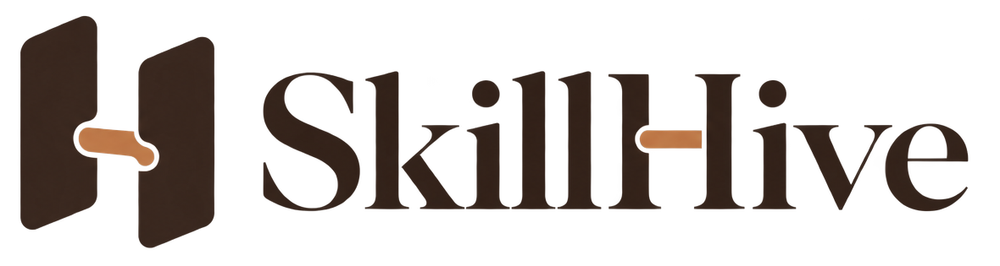
</p>

<h1 align="center">Make every agent understand your team.</h1>

<p align="center">
  <strong>SkillHive is the private context center for your team's agents.</strong><br />
  It runs on your own server and sits between your team and its agents: one side gathers the team's skills and documents, the other hands them to agents over MCP, permission by permission.
</p>

<p align="center">
  <a href="LICENSE"></a>
  <a href="https://github.com/kun001/skillhive/releases"></a>
  
  <a href="#mcp-hand-team-context-to-your-agents"></a>
</p>

<p align="center">
  <a href="README.md">简体中文</a> · <strong>English</strong> · <a href="https://skillhive.team">Live demo</a> · <a href="https://skillhive.team/changelog">Changelog</a>
</p>

<p align="center">
  <a href="https://skillhive.team">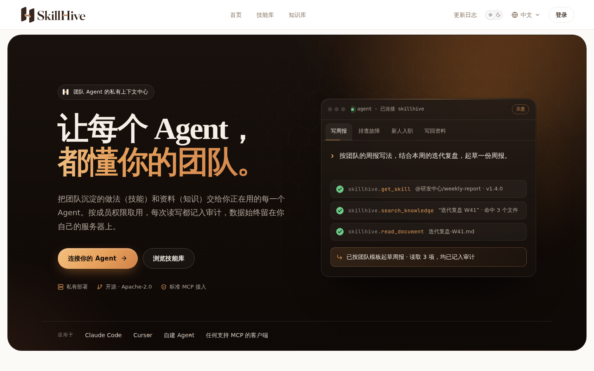</a>
</p>

<sub>Screenshots show the Chinese UI; switch to English in the top bar.</sub>

## Agents are smart, but they don't know your team

Models know most things about the world, yet nothing about your conventions, your templates, or the decision you made last week. So every conversation starts from scratch:

- **01 Context by copy and paste**: download files from a drive, paste them into the chat, and repeat for every new tool or teammate.
- **02 Good practices scattered everywhere**: the prompts and workflows that work live in personal notes and chat history; nobody knows which version is current or trustworthy.
- **03 Files you can't hand over**: uploading internal documents to a third-party AI platform rarely survives a security and compliance review.

**SkillHive puts all three in one place that you control.**

## One center, three layers of context

Practices, documents and boundaries, handed to agents in one go.

<p align="center">
  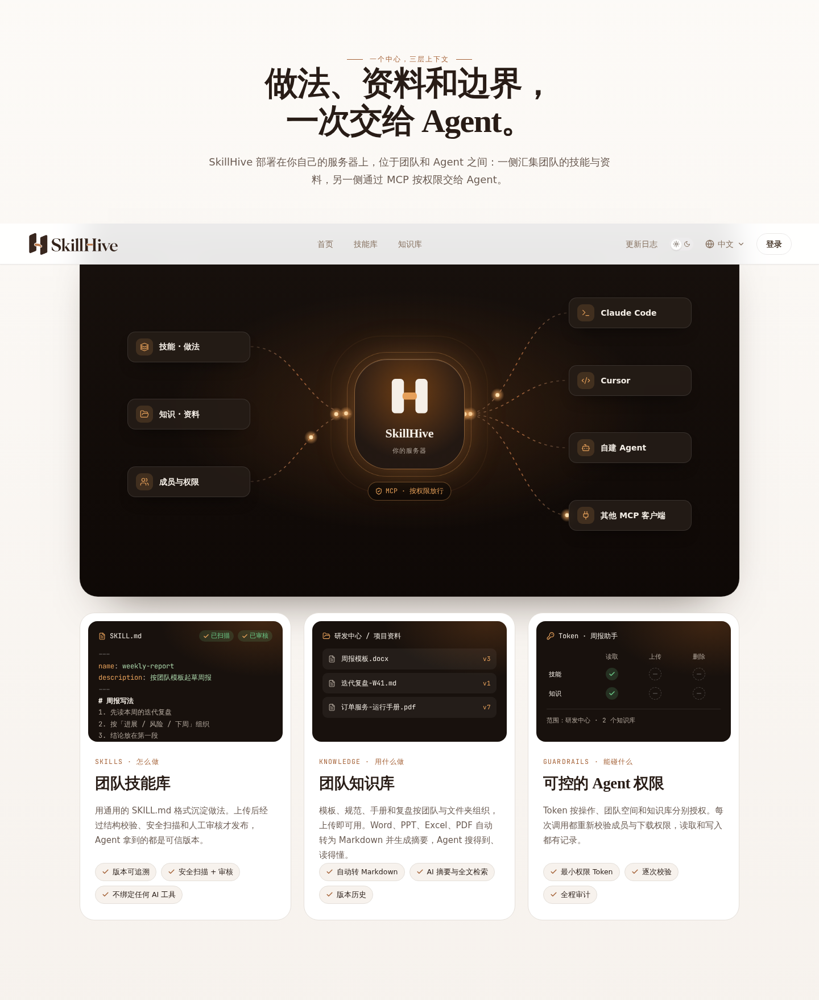
</p>

| Layer | What it is | What the agent gets |
| --- | --- | --- |
| **Skills · practices** | `SKILL.md` packages, published only after validation, security scanning and human review | "How our team does this" |
| **Knowledge · documents** | Files organized as team space → knowledge base → folder; Word, PowerPoint, PDF and more are extracted to Markdown | "The material needed to do it" |
| **Members & permissions · boundaries** | Space roles plus per-member read-only / edit / download permissions; every read is audited | "What I may and may not see" |

One sentence is enough for an agent to work the way your team does. In Claude Code, for example:

> "Draft this week's report the way our team writes weekly reports, using this sprint's retrospective."

Over MCP the agent calls `get_skill` for the weekly-report skill, `search_knowledge` for the retrospective and `read_document` for its text, all with your own read-only token, within your permissions, and with an audit trail.

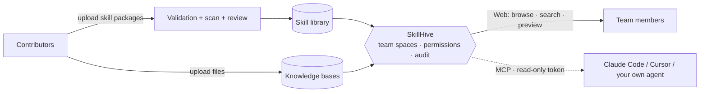

## Why SkillHive

| | Chats, drives, personal notes | Knowledge bases on third-party AI platforms | SkillHive |
| --- | --- | --- | --- |
| Where data lives | Scattered | A third-party platform | **Your own server** |
| Getting it to agents | Manual copy and paste | Only inside that platform | **Any MCP-capable agent** |
| Are practices trustworthy | Nobody checks | Depends on the platform | **Validated, scanned and reviewed before publishing** |
| Who can see it | Anyone with a forwarded link | The platform's accounts | **Team membership, with download permission controlled separately** |
| Traceability | None | Depends on the platform | **Every read audited, including which token** |

## See it in action

<table>
  <tr>
    <td width="50%">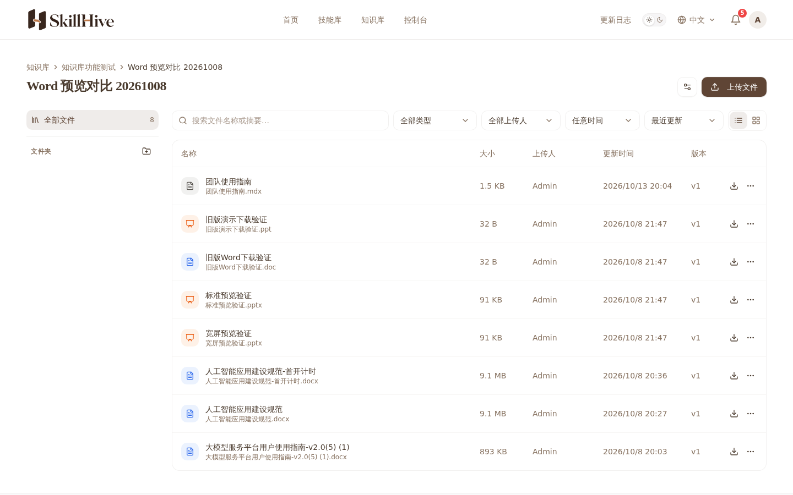<br /><sub><strong>Knowledge base</strong>: folders, batch uploads, filters by type and uploader</sub></td>
    <td width="50%">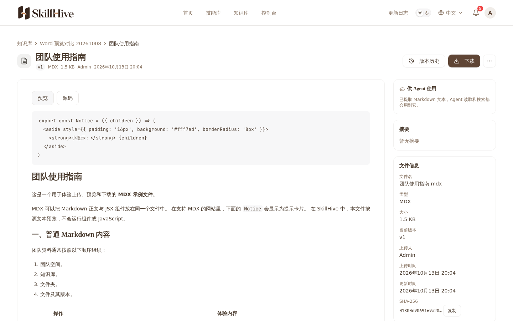<br /><sub><strong>File details</strong>: online preview, version history, whether agents can read it</sub></td>
  </tr>
  <tr>
    <td width="50%">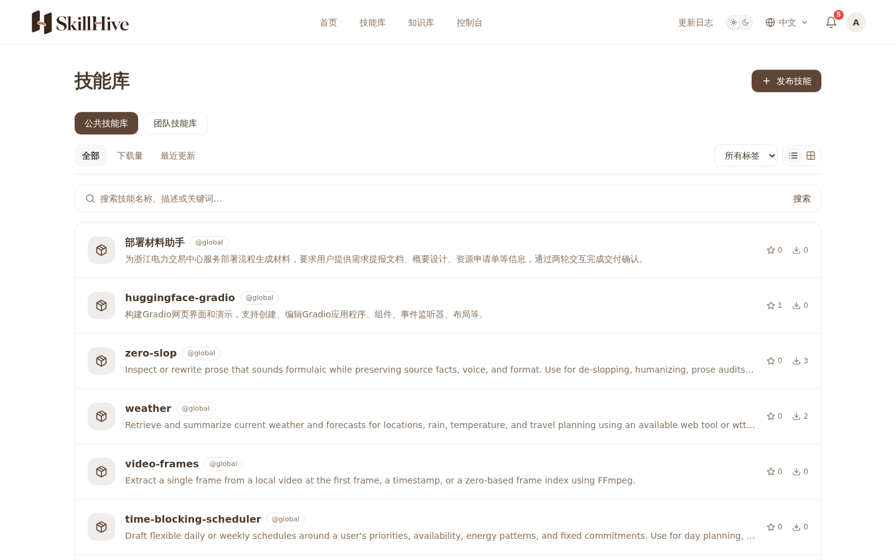<br /><sub><strong>Skill library</strong>: team and public skills, browse by tag and downloads</sub></td>
    <td width="50%">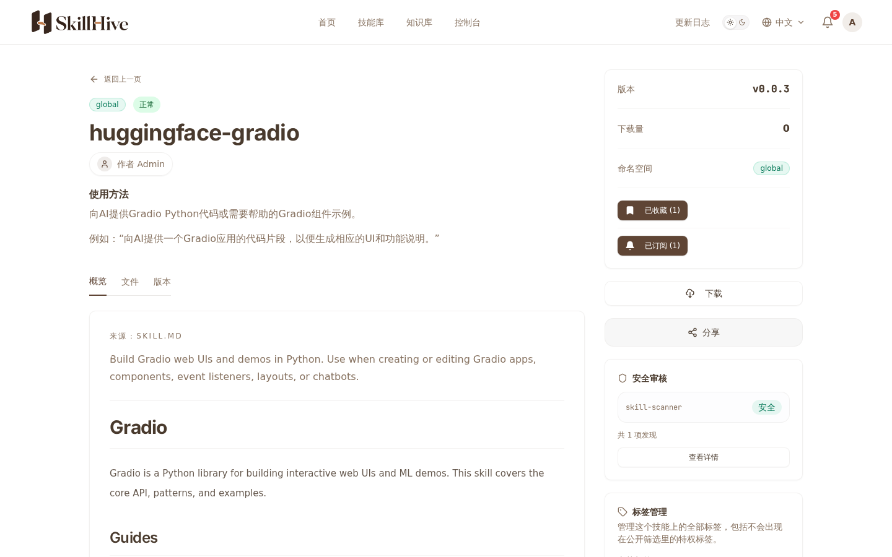<br /><sub><strong>Skill details</strong>: usage example, security review, versions</sub></td>
  </tr>
</table>

<sub>Screenshots come from a local instance with test data.</sub>

<details>
<summary><strong>More: animated tours of knowledge, skills and publishing</strong></summary>

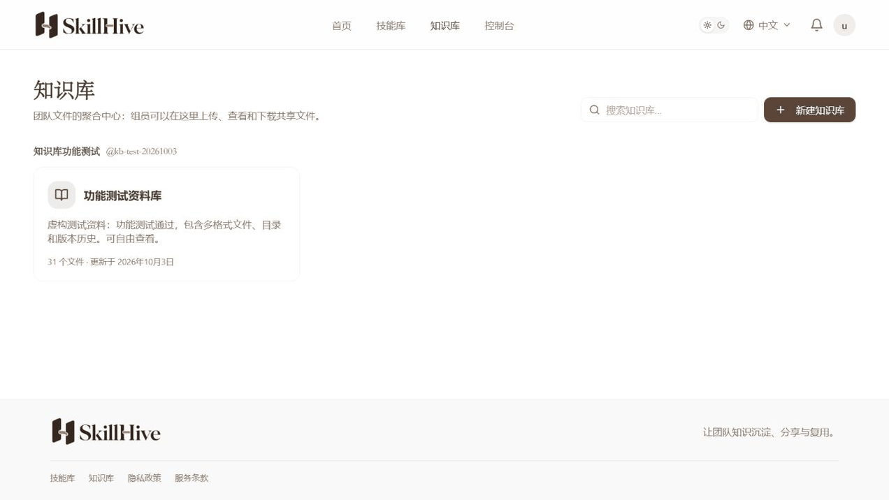

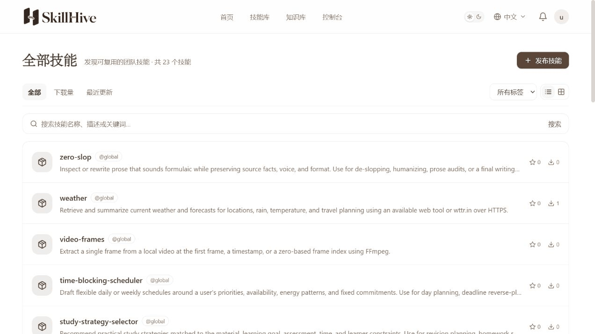

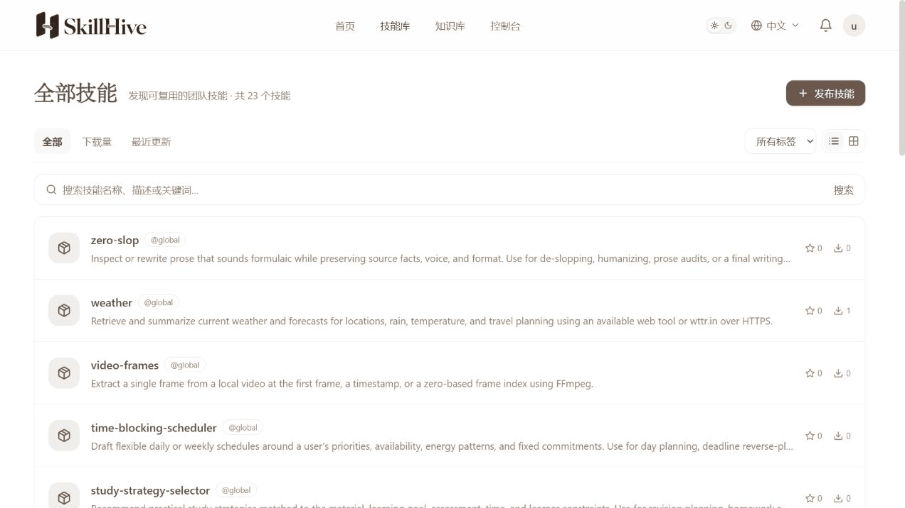

</details>

## Live demo

Demo site: **[https://skillhive.team](https://skillhive.team)**, running the latest release. The [site changelog](https://skillhive.team/changelog) lists what is deployed.

## MCP: hand team context to your agents

SkillHive provides read-only [MCP access](mcp/README.md) over remote Streamable HTTP or local stdio. Once configured, your AI tool uses your own API token to search, browse and read the skills and knowledge files you can access, with no manual downloading or copy-pasting. Read results are passed to the AI tool you choose.

Ask your AI things like:

- "Find the expense-claim documents in our team knowledge base and summarize the key steps."
- "Use the `meeting-notes` skill from our skill library to tidy up these notes."
- "Which frontend skills does our space have? Read the latest version's instructions."

| Property | What it means |
| --- | --- |
| **Read-only** | Use only `skill:read` and/or `knowledge:read`. Tokens with write scopes are refused, so the AI cannot change anything. |
| **Team permissions apply** | Read published public skills and authorized content in your teams. Reading team files requires download permission; platform administrators' tokens cannot bypass membership or download checks. |
| **Readable by agents** | Word, PowerPoint, Excel, PDF and text files are extracted to Markdown on the server; `read_document` returns that Markdown by default (with the AI summary when available) and other files unchanged. |
| **Traceable** | Knowledge files and skill files read with a token are recorded in the audit log, naming the token. |
| **Grant only what you need** | Skill and knowledge access are granted separately, and the MCP server only offers the tools for what the token can reach. |

13 tools: `whoami`, `get_team_guide` (team guide); skills: `search_skills`, `get_skill`, `list_skill_versions`, `list_skill_files`, `read_skill_file`, `list_my_skills`; knowledge: `list_knowledge_bases`, `browse_knowledge_base`, `search_knowledge`, `get_document`, `read_document`.

### Remote access: configure a URL and token

The remote endpoint ships with the backend and needs no additional MCP container or local Node.js installation. **After deploying a version containing this feature**, configure an agent that supports Streamable HTTP and custom authentication headers:

1. Open **Profile → API Tokens** and create a read-only token. Set skill access to **Read-only** or **None**; enable **Knowledge (read-only)** when needed.
2. Click **Copy MCP configuration**, or use the JSON below with your own instance URL and token.
3. Enable the MCP connection in your agent, then ask it to find skills or files. Call `whoami` first to confirm the current user and teams.

```json
{
  "mcpServers": {
    "skillhive": {
      "type": "http",
      "url": "https://your-skillhive.example.com/api/v1/mcp",
      "headers": {
        "Authorization": "Bearer <YOUR_READ_ONLY_TOKEN>"
      }
    }
  }
}
```

For local testing, use `http://localhost:3000/api/v1/mcp`. Each user supplies their own token. Token revocation, membership removal and download permission changes apply to subsequent calls. Remote file reads are capped at **10 MiB**; larger files can be downloaded from the web. Keep credentials in private client configuration. Clients requiring OAuth sign-in without custom authentication headers are not supported yet.

### Local stdio access

Requires Node.js 20+ and pnpm. Run `make build-mcp`, then configure the MCP client to launch the local process, for example with Claude Code:

```bash
claude mcp add skillhive \
  -e SKILLHIVE_URL=https://your-skillhive.example.com \
  -e SKILLHIVE_TOKEN=sk_xxx \
  -- node /path/to/skillhive/mcp/dist/index.js
```

See [mcp/README.md](mcp/README.md) for other clients, every tool and troubleshooting, and the [MCP server design](skillhive-docs/26-mcp-server.md) for the permission model.

## Features

| Area | What you can do |
| --- | --- |
| **Skill library** | Upload packages containing `SKILL.md`; read instructions, bundled files and version history; publish after validation, security scanning and review; star and subscribe; browse by keyword, label and sort order; unpublish and hide. |
| **Knowledge bases** | Nested folders; batch file or folder uploads that preserve the directory hierarchy and require a second confirmation; progress and retry; Markdown images and controlled MDX previews; version history, download or restore a chosen version; search by title, summary and text across knowledge bases. |
| **Team spaces** | One page shows the space's skills and knowledge bases; member management with per-member read-only, editable and download permissions that apply immediately. |
| **AI access** | Remote HTTP / local stdio MCP for reading skills and knowledge files with personal read-only tokens; copy connection configuration from your profile and grant skill and knowledge access separately. |
| **Governance** | Platform and space roles; notifications; audit log of key operations, including knowledge file downloads and previews and token reads of skills and files. |
| **Interface** | Chinese and English; light and dark themes; works on phones and narrow screens. |

<details>
<summary><strong>Skill package format</strong></summary>

A skill package uses `SKILL.md` to describe its name, purpose and instructions, and can include scripts, references and assets.

```text
meeting-notes/
├── SKILL.md
├── references/    # reference material (optional)
├── scripts/       # scripts (optional)
└── assets/        # supporting assets (optional)
```

Example `SKILL.md`:

```markdown
---
name: meeting-notes
description: Organize meeting notes into conclusions and follow-up actions.
---

# Meeting notes

Read the meeting notes, summarize conclusions by topic, and list action items with owners and due dates.
```

Skill versions are published after validation, scanning and review. Search and downloads only use published versions, and access is still permission-controlled.

</details>

<details>
<summary><strong>Supported knowledge files</strong></summary>

Files are organized as **team space → knowledge base → folder → file**, up to **100 MiB** per file.

| File type | Formats | How members use them |
| --- | --- | --- |
| PDF | `.pdf` | Preview online, download the original. |
| Images | `.png`, `.jpg`, `.jpeg`, `.gif`, `.webp` | Preview online, download the original. |
| Markdown / text | `.md`, `.markdown`, `.txt` | Read online; Markdown can be uploaded and shown with its local images. |
| MDX | `.mdx` | Upload, download and version management; Markdown, built-in callouts/accordions/tabs/steps/cards and local images, with a source toggle. Document code is never executed. |
| Word / PowerPoint | `.docx`, `.pptx` | Full document preview in the browser; original download. |
| Legacy Word / PowerPoint | `.doc`, `.ppt` | Upload, download and version management; no online preview. |
| Spreadsheets / data | `.xls`, `.xlsx`, `.csv`, `.json` | Upload, download and version management. |
| Archives | `.zip`, `.rar`, `.7z` | Upload, download and version management. |

Uploaded files are available to authorized members immediately and are not open to anonymous visitors by default. DOCX and PPTX render in the browser; layout may differ from Microsoft Office. Members with download permission can download originals if preview fails. Browser previews require file bytes: download permission controls download actions and the regular download endpoint, but cannot prevent extracting preview data from the browser.

See [controlled MDX previews](skillhive-docs/mdx-preview.md) for supported syntax and security boundaries. Upload the [sample document](examples/mdx/团队使用指南.mdx) together with its [image](examples/mdx/images/workflow.png).

To upload a folder, choose **Upload files → Select folder**, check the destination and directory preview, then confirm the upload. The selected top folder and its subdirectories are retained; existing folders with the same name are not merged. Retry failed files in the same dialog. Browsers cannot upload empty folders. See [folder uploads and MDX](skillhive-docs/folder-upload-mdx.md) for details (in Chinese).

</details>

**Scope**: SkillHive manages resources through the Web and does not run skill scripts; the MCP server is read-only and cannot publish or change content. Knowledge search matches titles, descriptions, AI summaries and extracted text. It does not provide vector search, RAG Q&A, OCR for scans or online co-editing.

## Deployment

SkillHive is built for teams that deploy it in their own environment. Every service runs in a container:

| Service | Role |
| --- | --- |
| Web and backend API | Interface and business logic (React / Spring Boot) |
| Skill scanner | Security scanning of skill packages |
| PostgreSQL, Redis | Data and cache |
| File storage | Local disk, S3 or MinIO |

The live demo runs all services on a single 2-core, 4 GB server, with a memory limit on each service. This setup has not been load-tested, so size larger teams on their actual workload.

| Configuration in this repository | Purpose |
| --- | --- |
| [Deployment configuration](skillhive-docs/09-deployment.md) | Authentication, database, storage and environment variables. |
| [Design docs](skillhive-docs/skillhive-architecture.md) | Product scope, architecture and an index of topic docs (in Chinese). |
| [MCP server](mcp/README.md) | Let AI tools read the skill library and knowledge base with a read-only token. |
| [.env.release.example](.env.release.example) | Runtime template; copy it to `.env.release` and edit it. |
| [compose.release.yml](compose.release.yml) | Containers for the frontend, backend, scanner, database and Redis. |

The deployment configuration uses the images published from this repository by default: `ghcr.io/kun001/skillhive-server`, `skillhive-web` and `skillhive-scanner` (pushes to `main` publish `edge`; `vX.Y.Z` tags publish that version and `latest`). You can also substitute your own builds. Configure images, accounts, storage and secrets, then start the services as described in the deployment guide.

## Development and documentation

### Architecture

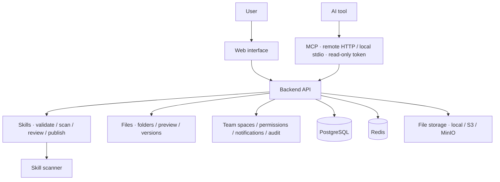

The frontend uses **React 19, TypeScript, Vite and TanStack Query**; the backend uses **Java 21, Spring Boot and Maven modules**. The skill scanner uses Python. DOCX and PPTX previews run in the browser, with no separate Office conversion service.

Skills and knowledge files have separate domain models and share users, team spaces, object storage and governance. The backend separates controllers, application services and domain services, and the frontend keeps the API in sync through generated OpenAPI types.

### Common development commands

Run these from the repository root in a Linux / WSL environment with the development dependencies:

| Command | Purpose |
| --- | --- |
| `make test-backend-app` | Test the backend application module and its dependencies. |
| `make typecheck-web` | Type-check the frontend. |
| `make lint-web` | Lint the frontend. |
| `make test-frontend` | Run frontend unit tests. |
| `make build-frontend` | Build frontend production assets. |
| `make generate-api` | Generate frontend OpenAPI types from a running backend. |

Run `make generate-api` after changing backend API contracts, and do not edit `web/src/api/generated/schema.d.ts` by hand. Database changes only add new Flyway migrations and never modify existing ones. Before a release, run container regression covering skill publishing and downloads, knowledge file permissions, uploads, previews and versions. See [changelog maintenance](skillhive-docs/changelog-maintenance.md) for how release notes are kept.

### Roadmap

MCP currently supports remote HTTP and local stdio with personal read-only tokens. Future directions include remote OAuth authorization, write actions that the user confirms (such as publishing a skill), and tokens limited to a single team; see the [MCP server design](skillhive-docs/26-mcp-server.md). The backend API mainly serves the Web interface and MCP and is not yet published as a complete open API. See the [development changelog](CHANGELOG.md) for pending changes and the [site changelog](https://skillhive.team/changelog) for deployed releases.

## Acknowledgements

Thanks to [iflytek/skillhub](https://github.com/iflytek/skillhub) for the open-source foundation, and to [Tencent/WeKnora](https://github.com/Tencent/WeKnora) for reference on knowledge organization, interaction and document display.

## License

This project is licensed under the **Apache License 2.0**, with the relevant copyright and license notices retained. See [LICENSE](LICENSE) for the full terms. Third-party dependencies and assets follow their own licenses.
