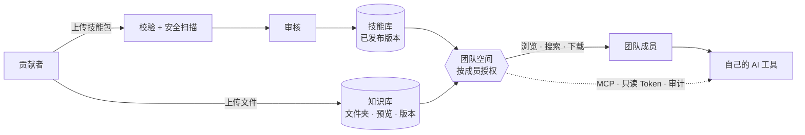
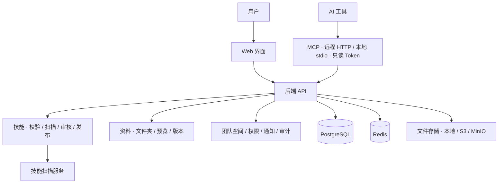

<p align="center">
  
</p>

<h3 align="center">私有部署的团队 AI 技能与资料共享中心</h3>

<p align="center">
  技能经审核再发布，资料上传即共享，都放在同一个团队空间里；<br />
  AI 工具通过 MCP 按你的权限直接查阅，数据留在你自己的服务器上。
</p>

<p align="center">
  <a href="LICENSE"></a>
  
  
  <a href="#mcp让-ai-直接查阅团队技能和资料"></a>
</p>

<p align="center">
  <strong>简体中文</strong> · <a href="README.en.md">English</a>
  <br />
  <a href="#为什么选择-skillhive">为什么选择</a> · <a href="#mcp让-ai-直接查阅团队技能和资料">MCP 接入</a> · <a href="#在线体验">在线体验</a> · <a href="#产品演示">产品演示</a> · <a href="#功能一览">功能一览</a> · <a href="#部署">部署</a> · <a href="#开发与文档">开发与文档</a>
</p>

## 为什么选择 SkillHive

**v0.2.0** 新增 MDX 受控预览、保留目录层级的文件夹上传与远程 MCP 接入。变更见 [版本更新记录](CHANGELOG.md)；演示站实际部署的版本以 [站点更新日志](https://skillhive.team/changelog) 为准。

<table>
  <tr>
    <td width="33%" valign="top">
      <strong>私有部署，数据不出团队</strong><br /><br />
      用 Docker Compose 部署在自己的服务器或内网，文件可存放在本地磁盘、S3 或 MinIO。线上演示站运行在一台 2 核 4 GB 的服务器上。
    </td>
    <td width="33%" valign="top">
      <strong>技能先审核，再进团队</strong><br /><br />
      技能包上传后要经过结构与元数据校验、<a href="https://github.com/cisco-ai-defense/skill-scanner">Cisco AI Skill Scanner</a> 安全扫描和人工审核，通过后才会发布，减少带风险的脚本流入团队。
    </td>
    <td width="33%" valign="top">
      <strong>方法和资料，一处取用</strong><br /><br />
      团队空间页同时列出该空间的技能和知识库，还能跨知识库搜索文件。“怎么做”和“用什么做”，在同一个入口找到。
    </td>
  </tr>
  <tr>
    <td valign="top">
      <strong>资料能预览，改动可回溯</strong><br /><br />
      PDF、图片、Markdown（含配图）在线查看，MDX 受控组件预览与源码切换，Word / PowerPoint 在浏览器中预览。每次更新都保留版本，可下载或恢复历史版本。
    </td>
    <td valign="top">
      <strong>权限细到每位成员</strong><br /><br />
      在空间角色之外，可为每位成员单独设置只读或可编辑，以及是否允许下载，调整后立即生效。关键操作都记入审计日志。
    </td>
    <td valign="top">
      <strong>AI 工具直接查阅（MCP）</strong><br /><br />
      Claude Code、Cursor 等 AI 工具通过 <a href="#mcp让-ai-直接查阅团队技能和资料">MCP 服务</a>，用你的只读 Token 搜索和读取技能与知识库文件。支持远程 HTTP 或本地 stdio 接入，后端逐次校验权限，文件读取记入审计。技能采用通用的 <code>SKILL.md</code> 格式，不绑定任何 AI 工具，平台本身不执行技能脚本。
    </td>
  </tr>
</table>

### 和常见做法比一比

| | 群聊、网盘、个人笔记 | SkillHive |
| --- | --- | --- |
| 好用的 AI 技能 | 散落在聊天记录里，不知道哪个是最新版 | 集中存放，附说明、版本和下载量 |
| 技能是否安全 | 拿来直接用，没人检查 | 校验、安全扫描、人工审核后才发布 |
| 模板和资料 | 多处副本，难以确认哪份最新 | 统一入口，版本历史可回溯 |
| 找东西 | 翻聊天记录、问同事 | 按团队空间浏览，跨知识库搜索 |
| 谁能访问 | 链接一转发就能看 | 仅团队成员可见，下载权限单独控制 |
| 让 AI 用上团队资料 | 手动下载、复制粘贴进对话框 | AI 工具通过 MCP 按你的权限直接查阅，读取留有审计 |
| 数据在哪 | 第三方平台 | 你自己的服务器 |

### 它是怎么工作的



举个例子：团队把“会议纪要整理”技能发布到技能库，把会议模板和项目资料放进知识库。新成员打开团队空间，就能同时找到这套方法和配套资料；也可以直接在 Claude Code 里说“用团队的会议纪要技能和模板整理这份记录”，AI 通过 MCP 自己找到技能和模板来完成。

## MCP：让 AI 直接查阅团队技能和资料

SkillHive 提供只读 [MCP 接入](mcp/README.md)，支持远程 Streamable HTTP 和本地 stdio 两种方式。配置后，AI 可以用你自己的 API Token 搜索、浏览和读取有权访问的技能与知识库文件，不用再手动下载、复制粘贴。读取结果会交给你选择的 AI 工具处理。

你可以直接这样问 AI：

- “在团队知识库里找一下报销流程相关的文件，总结关键步骤。”
- “用团队技能库里的 `meeting-notes` 技能，整理这份会议记录。”
- “看看我们空间里有哪些前端相关的技能，读一下最新版本的说明。”

| 特点 | 说明 |
| --- | --- |
| **只读** | 仅使用 `skill:read` 和 / 或 `knowledge:read`；带写入权限的 Token 无法接入，AI 不能修改任何内容。 |
| **按团队权限读取** | 可读取公开的已发布技能和自己团队有权查看的内容，读取团队文件需要下载权限；平台管理员的 Token 也不能绕过团队成员及下载权限检查。 |
| **原样传递** | 文本文件直接返回文本，PDF、Word 等返回原文件交给 AI 工具处理，平台不做内容解析。 |
| **可追溯** | 通过 Token 读取的知识库文件和技能文件都记入审计日志，标明是哪个 Token。 |
| **按需授权** | 技能库与知识库分开授权，Token 只授予哪一边，MCP 就只提供哪一边的工具。 |

提供 12 个工具：`whoami`；技能库 `search_skills`、`get_skill`、`list_skill_versions`、`list_skill_files`、`read_skill_file`、`list_my_skills`；知识库 `list_knowledge_bases`、`browse_knowledge_base`、`search_knowledge`、`get_document`、`read_document`。

### 远程接入：填写地址和 Token 即可使用

远程入口随后端一起部署，无需额外 MCP 容器或本地 Node.js。**部署包含此功能的版本后**，在支持 Streamable HTTP 和自定义认证 Header 的 Agent 中按以下步骤配置：

1. 在 SkillHive「个人中心 → Token 凭证」创建只读 Token。技能库选「只读」或「不授予」，需要知识资料时勾选「知识库（只读）」。
2. 点击「复制 MCP 配置」，或使用下面的 JSON，将地址改为自己的 SkillHive 实例，并填入自己的 Token。
3. 在 Agent 中启用该 MCP 服务，再用自然语言查找技能或资料。可先调用 `whoami` 确认当前用户和团队。

```json
{
  "mcpServers": {
    "skillhive": {
      "type": "http",
      "url": "https://your-skillhive.example.com/api/v1/mcp",
      "headers": {
        "Authorization": "Bearer <YOUR_READ_ONLY_TOKEN>"
      }
    }
  }
}
```

本地验证将 URL 改为 `http://localhost:3000/api/v1/mcp`。每位用户使用自己的 Token；撤销 Token、移除团队成员或关闭下载权限后，后续调用会立即按新权限执行。远程文件读取上限为 **10 MiB**，超限可在网页下载。配置含凭据，应保存在客户端私有配置中。只支持 OAuth 登录、不能填写认证 Header 的客户端暂不适用。

### 本地 stdio 接入

需要 Node.js 20+ 和 pnpm。先运行 `make build-mcp`，再让 MCP 客户端启动本地进程，以 Claude Code 为例：

```bash
claude mcp add skillhive \
  -e SKILLHIVE_URL=https://your-skillhive.example.com \
  -e SKILLHIVE_TOKEN=sk_xxx \
  -- node /path/to/skillhive/mcp/dist/index.js
```

其他客户端的配置、全部工具说明和常见问题见 [mcp/README.md](mcp/README.md)，设计与权限模型见 [MCP 服务设计](skillhive-docs/26-mcp-server.md)。

## 在线体验

演示地址：**[https://skillhive.team](https://skillhive.team)**

在[登录页面](https://skillhive.team/login)使用下面任一账号登录。它们都是普通成员，只能看到各自有权限的团队资源。

| 用户名 | 密码 | 上传的技能 |
| --- | --- | --- |
| `curator_ui` | `Sh!7VoU_FOwrzDZFdcvPQiwuVzxOzyPcUsux` | `web-design-guidelines` |
| `curator_database` | `Sh!78xMg-9z_LvslyHrCWazr1zB30gCtwi2W` | `supabase-postgres-best-practices` |
| `curator_content` | `Sh!7jspLLunXXasAgMlo-vXz1pc9ANLeeaTx` | `baoyu-markdown-to-html` |
| `curator_ai` | `Sh!7x0hZiBWJ_8teeVCdT1NMMEEAtUFVa73u` | `huggingface-gradio` |

## 产品演示

### 找到资料，预览并查看版本

从知识库进入文件夹，打开文档预览，再查看和下载需要的历史版本。


<details>
<summary><strong>查看技能说明、包内文件和已发布版本</strong></summary>

在技能库找到技能，阅读说明，切换到包内文件预览 `SKILL.md`，再查看已发布版本。


</details>

<details>
<summary><strong>发布技能：选择团队空间和可见范围</strong></summary>

从技能库点击“发布技能”，选择目标空间和可见范围，再上传技能包。提交的版本经过校验、安全扫描和审核后发布。


</details>

以上动图录自本地 Web 界面，知识库资料为虚构的测试资料。

## 功能一览

| 模块 | 能做什么 |
| --- | --- |
| **技能库** | 上传含 `SKILL.md` 的技能包；查看说明、包内文件和版本历史；校验、安全扫描、审核后发布；收藏、订阅；按关键词、标签和排序浏览；下架与隐藏。 |
| **知识库** | 多层文件夹；批量上传文件或文件夹，保留目录层级并在上传前二次确认；进度查看与失败重试；Markdown 配图、MDX 受控预览；版本历史、指定版本下载与恢复；按标题和描述搜索，可跨知识库。 |
| **团队空间** | 一个页面同时展示空间内的技能和知识库；成员管理，按成员设置只读、可编辑和下载权限，调整即时生效。 |
| **AI 接入** | 远程 HTTP / 本地 stdio MCP，让 AI 工具用个人只读 Token 查阅技能和知识文件；个人中心可复制连接配置，技能库与知识库分开授权。 |
| **治理** | 平台角色与空间角色；业务通知；关键操作审计日志，包括知识文件的下载与预览、通过 Token 读取技能和资料。 |
| **界面** | 中文、English；浅色 / 深色主题；适配手机和窄屏。 |

<details>
<summary><strong>技能包格式</strong></summary>

技能包以 `SKILL.md` 描述名称、用途和执行指令，可以附带脚本、参考材料和配套资源。

```text
meeting-notes/
├── SKILL.md
├── references/    # 参考材料（可选）
├── scripts/       # 脚本（可选）
└── assets/        # 配套资源（可选）
```

`SKILL.md` 示例：

```markdown
---
name: meeting-notes
description: 整理会议记录，提取讨论结论与后续待办。
---

# 会议记录整理

阅读输入的会议记录，按讨论主题整理结论，并列出待办事项、负责人和期限。
```

技能版本经过校验、扫描和审核后发布。检索和下载只使用已发布版本，访问仍受权限控制。

</details>

<details>
<summary><strong>支持的知识文件</strong></summary>

资料按 **团队空间 → 知识库 → 文件夹 → 文件** 组织，单个文件上限 **100 MiB**。

| 文件类型 | 支持格式 | 取用方式 |
| --- | --- | --- |
| PDF | `.pdf` | 在线预览、下载原文件。 |
| 图片 | `.png`、`.jpg`、`.jpeg`、`.gif`、`.webp` | 在线预览、下载原文件。 |
| Markdown / 文本 | `.md`、`.markdown`、`.txt` | 在线阅读；Markdown 支持连同本地图片上传与展示。 |
| MDX | `.mdx` | 上传、下载与版本管理；支持 Markdown、内置提示/折叠/标签页/步骤/卡片组件与本地配图，可切换源码；不执行文档代码。 |
| Word / PowerPoint | `.docx`、`.pptx` | 网页端全文预览、下载原文件。 |
| 旧版 Word / PowerPoint | `.doc`、`.ppt` | 上传、下载与版本管理，不支持在线预览。 |
| 表格 / 数据 | `.xls`、`.xlsx`、`.csv`、`.json` | 上传、下载与版本管理。 |
| 压缩包 | `.zip`、`.rar`、`.7z` | 上传、下载与版本管理。 |

知识文件上传成功即可供有权限的成员访问，默认不向匿名用户开放。DOCX、PPTX 由浏览器渲染，排版可能与 Microsoft Office 略有差异；预览失败时，有下载权限的成员可下载原文件。预览成员需要获取文件数据，因此下载权限控制的是下载入口与普通下载接口，无法阻止从浏览器提取预览数据。

MDX 支持范围、配图与安全边界见 [MDX 受控预览](skillhive-docs/mdx-preview.md)，可下载 [示例文档](examples/mdx/团队使用指南.mdx) 与 [配套图片](examples/mdx/images/workflow.png) 一起上传。

上传文件夹：选择「上传文件 → 选择文件夹」，核对目标位置和目录预览，再确认开始上传。保留所选顶层文件夹及子目录，不自动合并同名目标目录；失败文件可在当前弹窗重试。浏览器无法上传空文件夹。详见 [文件夹上传与 MDX](skillhive-docs/folder-upload-mdx.md)。

</details>

**边界说明**：SkillHive 通过 Web 管理资源，不在平台内执行技能脚本；MCP 服务只读，不能通过它发布或修改内容。知识文件搜索匹配标题和描述（标题默认取自文件名），不检索正文，也不提供文档解析、向量检索、RAG 问答或在线协同编辑。

## 部署

SkillHive 面向在自己环境中部署的团队。所有服务都以容器运行：

| 服务 | 作用 |
| --- | --- |
| Web 与后端 API | 界面与业务逻辑（React / Spring Boot） |
| 技能扫描服务 | 技能包安全扫描 |
| PostgreSQL、Redis | 数据与缓存 |
| 文件存储 | 本地磁盘、S3 或 MinIO |

线上演示站在一台 2 核 4 GB 的服务器上运行全部服务，各服务设置了内存上限。这一配置尚未做并发容量测试，团队人数较多时请按实际负载评估。

| 仓库内配置 | 用途 |
| --- | --- |
| [部署配置](skillhive-docs/09-deployment.md) | 认证、数据库、存储与环境变量配置。 |
| [设计文档](skillhive-docs/skillhive-architecture.md) | 产品边界、架构与各专题文档的导航。 |
| [MCP 服务](mcp/README.md) | 让 AI 工具用只读 Token 访问技能库和知识库。 |
| [.env.release.example](.env.release.example) | 运行参数模板，部署时复制为 `.env.release` 并修改。 |
| [compose.release.yml](compose.release.yml) | 前端、后端、扫描器、数据库与 Redis 的容器编排。 |

部署配置默认使用由本仓库发布的镜像 `ghcr.io/kun001/skillhive-server`、`skillhive-web`、`skillhive-scanner`（推送到 `main` 发布 `edge`，推送 `vX.Y.Z` 标签发布对应版本与 `latest`），也可以替换为自建镜像。完成镜像、账户、存储和密钥配置后，再按部署文档启动服务。

## 开发与文档

### 系统架构



前端使用 **React 19、TypeScript、Vite 与 TanStack Query**，后端使用 **Java 21、Spring Boot 与 Maven 多模块**。技能扫描服务使用 Python；DOCX、PPTX 预览在浏览器中完成，无需独立 Office 转换服务。

技能与知识文件拥有独立的领域模型，共享用户、团队空间、对象存储和治理设施。后端按控制器、应用服务与领域服务划分职责，前端通过生成的 OpenAPI 类型保持接口一致。

### 常用开发命令

在具备开发依赖的 Linux / WSL 环境中，于仓库根目录执行：

| 命令 | 用途 |
| --- | --- |
| `make test-backend-app` | 测试后端应用模块及其依赖。 |
| `make typecheck-web` | 检查前端 TypeScript 类型。 |
| `make lint-web` | 检查前端代码规范。 |
| `make test-frontend` | 运行前端单元测试。 |
| `make build-frontend` | 构建前端生产资源。 |
| `make generate-api` | 从运行中的后端生成前端 OpenAPI 类型。 |

后端接口契约改变后运行 `make generate-api`，不要手工修改 `web/src/api/generated/schema.d.ts`。数据库变更只新增 Flyway 迁移，不修改既有迁移。发布前需进行容器回归，覆盖技能发布与下载、知识文件权限、上传、预览和版本操作。更新日志的维护方式见 [更新日志维护](skillhive-docs/changelog-maintenance.md)。

### 扩展方向

MCP 当前支持个人只读 Token 的远程 HTTP 与本地 stdio 接入。后续方向包括远程 OAuth 授权、需用户确认的写入能力（如发布技能）以及限定到单个团队的 Token，见 [MCP 服务设计](skillhive-docs/26-mcp-server.md)。现有后端 API 主要服务于 Web 界面和 MCP，尚未作为完整的开放 API 发布；待发布改动见 [开发更新记录](CHANGELOG.md)，实际上线内容见 [站点更新日志](https://skillhive.team/changelog)。

## 致谢

感谢 [iflytek/skillhub](https://github.com/iflytek/skillhub) 提供的开源源码基础，以及 [Tencent/WeKnora](https://github.com/Tencent/WeKnora) 在知识管理组织、交互与文档展示方面提供的参考。

## 许可证

本项目采用 **Apache License 2.0**，保留相关版权与许可声明，完整条款见 [LICENSE](LICENSE)。第三方依赖及资源遵循各自的许可证。
